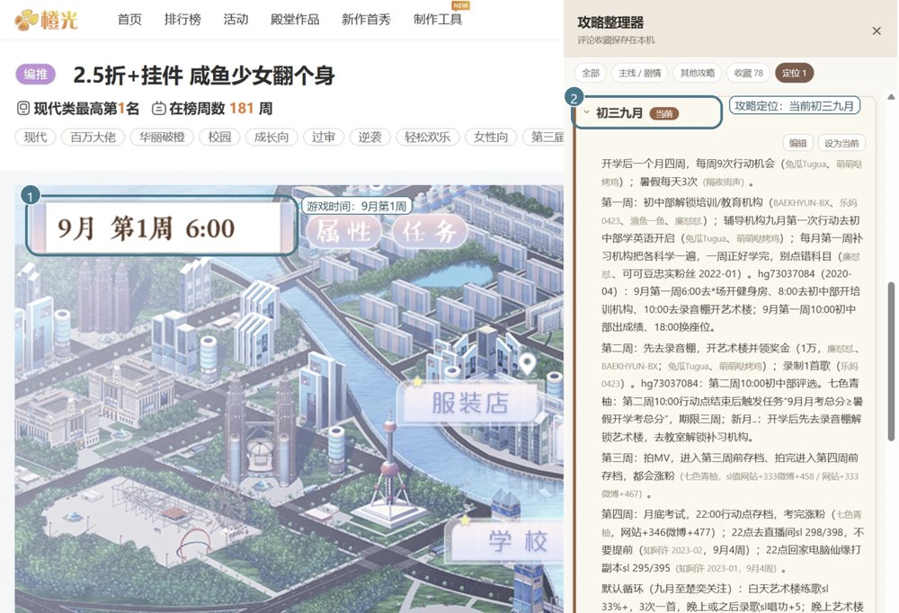

# orange-guides-ai

橙光游戏攻略的 AI 整合版。这里的攻略由 AI 整合自玩家评论，可能有错漏，请以原作者攻略和游戏实际内容为准。

## 攻略

- [咸鱼少女翻个身](咸鱼少女翻个身.md)
- 沧海仙途（按境界分篇，导入时只选当前境界那份）
  - [凡人期](沧海仙途/凡人期.md)
  - [练气期](沧海仙途/练气期.md)
  - [筑基期](沧海仙途/筑基期.md)
  - [金丹期](沧海仙途/金丹期.md)
  - [元婴期](沧海仙途/元婴期.md)
  - [化神期及之后](沧海仙途/化神期.md)
- 国服校花（按学段分篇，导入时只选当前学段那份）
  - [高一（第1-12月）](国服校花/高一.md)
  - [高二（第13-24月）](国服校花/高二.md)
  - [高三（第25-36月）](国服校花/高三.md)
  - [大学（第37月起）](国服校花/大学.md)
- 少女成长手札（按路线分篇，导入时只选你走的那条路线）
  - [宫妃路线（含闺阁期、郡主线）](少女成长手札/宫妃路线.md)
  - [夫人路线](少女成长手札/夫人路线.md)
  - [王妃路线](少女成长手札/王妃路线.md)
  - [旧版其他线路（将军线、官线）](少女成长手札/旧版其他线路.md)

## 定位演示

攻略可以导入[橙光攻略整理器](https://chromewebstore.google.com/detail/%E6%A9%99%E5%85%89%E6%94%BB%E7%95%A5%E6%95%B4%E7%90%86%E5%99%A8/cmajpjlhmelcjmcipgmegogmnnpinkhk)，在“定位”里按游戏进度查看。比如游戏显示“9月 第1周”时，会定位到“初三九月”。

